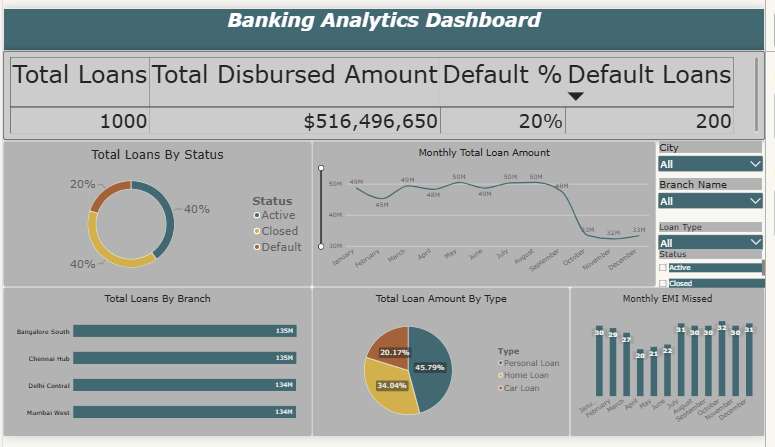
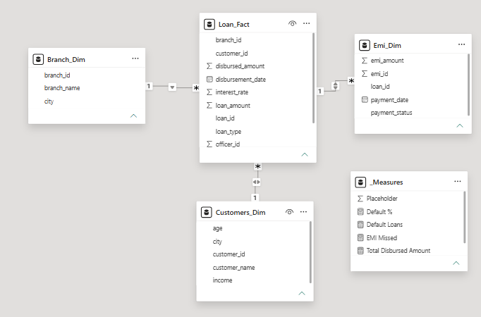
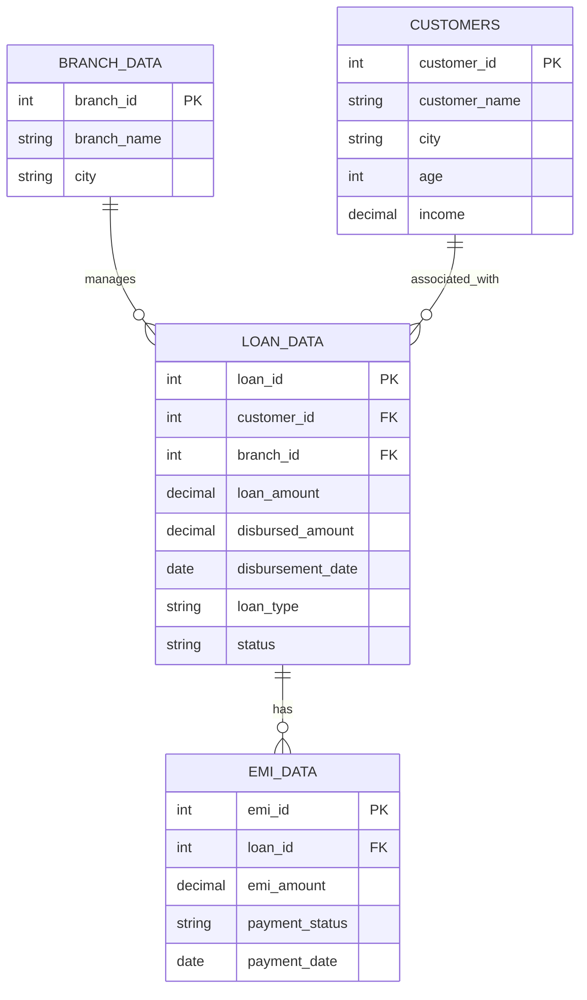
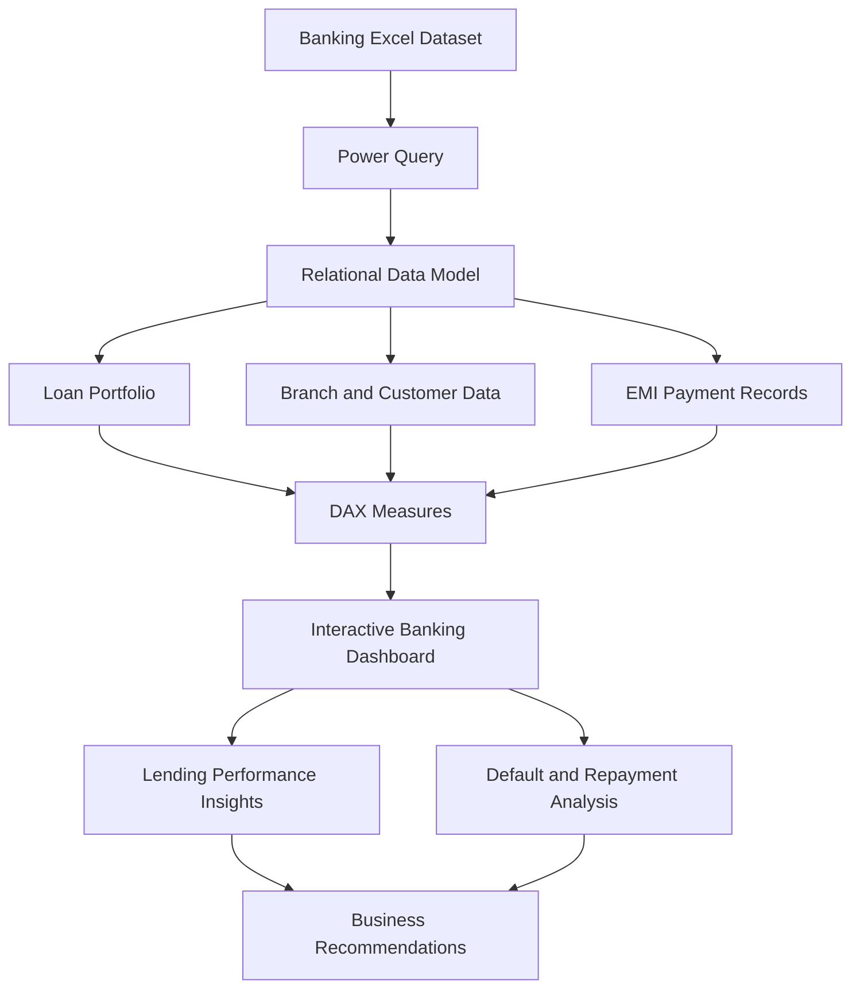

# Banking & Loan Analytics | Microsoft Power BI


## Project Overview

This project presents an interactive banking and loan portfolio analytics dashboard developed using Microsoft Power BI.

The project investigates loan disbursements, portfolio composition, loan default rates, branch performance, lending trends and equated monthly instalment (EMI) payment activity.

Using four interconnected datasets, the analysis combines relational data modelling, DAX calculations, financial KPIs and interactive visualisations to transform banking records into meaningful management information.

The objective is to support lending performance monitoring, credit risk reporting, repayment analysis and financial decision-making.

## Dashboard Preview



## Executive Summary

| Key Performance Indicator | Result |
|---|---:|
| Total Loans | 1,000 |
| Total Loan Amount | $538,161,650 |
| Total Disbursed Amount | $516,496,650 |
| Difference Between Loan and Disbursed Amounts | $21,665,000 |
| Defaulted Loans | 200 |
| Loan Default Rate by Count | 20.00% |
| Active Loans | 400 |
| Closed Loans | 400 |
| Average Disbursed Amount per Loan | $516,496.65 |
| Recorded EMI Payments | 1,000 |
| Missed EMI Records | 333 |
| Missed EMI Record Percentage | 33.30% |
| Banking Branches | 4 |
| Loan Categories | 3 |

The analysis identifies personal loans as the largest lending category by recorded loan amount.

The portfolio also contains a substantial proportion of defaulted loans and missed EMI records, highlighting areas that could benefit from further credit risk and repayment investigation.

The headline results were checked against the supplied Excel dataset and dashboard preview.

Monetary figures use the dollar formatting displayed in the dashboard. The underlying reporting currency has not been independently confirmed.

## Business Problem

Financial institutions require accurate and timely reporting to monitor lending activity, assess portfolio performance and identify potential credit risk.

Without consolidated analytical reporting, banking stakeholders may struggle to:

- Monitor the size and composition of loan portfolios.
- Identify changes in lending activity.
- Track defaulted loans.
- Investigate repayment issues.
- Compare branch-level lending performance.
- Evaluate exposure across different loan products.
- Identify potential data quality issues.
- Support informed lending and operational decisions.

This project addresses these requirements through an interactive Power BI banking analytics solution.

## Project Objectives

- Analyse overall loan portfolio performance.
- Calculate total loan and disbursement amounts.
- Measure loan default rates.
- Compare active, closed and defaulted loans.
- Investigate monthly lending patterns.
- Evaluate branch-level lending activity.
- Analyse loan portfolio composition by product type.
- Monitor missed EMI payment records.
- Develop reusable financial and operational DAX measures.
- Implement interactive reporting filters.
- Develop a relational Power BI data model.
- Assess source data quality and relationship integrity.
- Generate actionable financial and operational recommendations.

## Tools and Technologies

| Tool / Technique | Application |
|---|---|
| Microsoft Power BI Desktop | Interactive business intelligence reporting |
| Microsoft Excel | Source dataset storage |
| Power Query | Data connectivity and preparation |
| DAX | Financial and operational KPI calculations |
| Relational Data Modelling | Connecting loan and supporting datasets |
| Fact and Dimension Tables | Organising analytical data |
| Filter Context | Dynamic financial reporting |
| Date Hierarchies | Monthly lending and repayment analysis |
| KPI Reporting | Loan portfolio performance measurement |
| Slicers | Interactive banking portfolio segmentation |
| Line Charts | Lending trend analysis |
| Bar Charts | Branch-level comparisons |
| Pie and Donut Charts | Portfolio composition analysis |
| Column Charts | Missed EMI reporting |
| GitHub | Project documentation and version control |

## Dataset Overview

The source Excel workbook contains four worksheets covering branch information, customer records, loan transactions and EMI payment activity.

| Source Worksheet | Records | Description |
|---|---:|---|
| branch_data | 4 | Branch identifiers, names and locations |
| customers | 500 | Customer demographic and financial information |
| loan_data | 1,000 | Loan amounts, disbursements and lending characteristics |
| emi_data | 1,000 | Recorded instalment amounts and payment statuses |
| Total | 2,504 | Combined source records |

The loan disbursement dates range from 2 January 2022 to 27 September 2024.

### Branch Dataset

| Field | Description |
|---|---|
| branch_id | Unique branch identifier |
| branch_name | Banking branch name |
| city | Branch geographical location |

### Customer Dataset

| Field | Description |
|---|---|
| customer_id | Customer identifier |
| customer_name | Customer name or sample identifier |
| city | Customer geographical location |
| age | Recorded customer age |
| income | Recorded customer income |

### Loan Dataset

| Field | Description |
|---|---|
| loan_id | Unique loan identifier |
| customer_id | Associated customer identifier |
| loan_amount | Recorded loan amount |
| disbursed_amount | Recorded amount disbursed |
| disbursement_date | Loan disbursement date |
| loan_type | Loan product classification |
| branch_id | Associated banking branch |
| officer_id | Associated lending officer identifier |
| status | Active, Closed or Default |
| tenure_months | Recorded loan repayment term |
| interest_rate | Recorded loan interest rate |

### EMI Dataset

EMI stands for Equated Monthly Instalment, a scheduled repayment amount commonly associated with lending products.

| Field | Description |
|---|---|
| emi_id | Unique instalment record identifier |
| loan_id | Associated loan identifier |
| emi_amount | Recorded instalment amount |
| payment_status | Paid, Pending or Missed |
| payment_date | Recorded payment-related date |

## Data Model



The report references a central loan table and supporting analytical tables.

| Model Table | Analytical Purpose |
|---|---|
| Loan_Fact | Central loan portfolio records |
| Branch_Dim | Branch names and geographical information |
| Customers_Dim | Customer demographic and financial information |
| Emi_Dim | Instalment payment information |
| _Measures | Centralised DAX measure organisation |

### Logical Dataset Relationships

| Parent Dataset | Related Dataset | Joining Field |
|---|---|---|
| branch_data | loan_data | branch_id |
| customers | loan_data | customer_id |
| loan_data | emi_data | loan_id |

The model is designed to support loan portfolio analysis across branches, customers, product categories and repayment information.

The logical relationships above describe the intended source-data connections. Actual Power BI relationship cardinality and filter direction should be checked in Model View.

### Logical Relationship Diagram



This diagram represents the intended logical structure rather than a claim that all source foreign-key relationships have passed validation.

## Data Quality Assessment

Independent review of the source workbook identified an important customer relationship integrity issue.

| Data Quality Check | Result |
|---|---:|
| Customer Dimension Records | 500 |
| Distinct Customer IDs in Loan Data | 1,000 |
| Loan Records With Matching Customer IDs | 400 |
| Loan Records With Unmatched Customer IDs | 600 |
| Unmatched Customer ID Percentage | 60.00% |
| EMI Records With Unmatched Loan IDs | 0 |

### Customer Relationship Integrity

A substantial proportion of loan records do not have matching customer records in the customer dataset.

This creates a potential reporting limitation when analysing loan performance by customer characteristics or customer city.

Overall portfolio totals can still be calculated from the loan table independently.

However, customer-based filtering and segmentation require careful interpretation because the customer dimension does not cover all recorded borrowers.

Recommended corrective actions include:

- Reconcile customer identifiers between source datasets.
- Investigate missing customer dimension records.
- Validate customer-to-loan relationships.
- Introduce an unmatched customer reporting category where appropriate.
- Monitor relationship completeness through recurring data quality checks.
- Avoid using incomplete customer segmentation for operational lending decisions.

Unmatched customer records should not be assigned invented customer information.

## Analytical Workflow



## Analytical Methodology

### 1. Data Connectivity and Preparation

The four source worksheets are imported into Microsoft Power BI.

Power Query provides the data connectivity and preparation layer, enabling the banking records to be organised into separate analytical tables.

Important data preparation considerations include:

- Consistent loan and customer identifiers.
- Appropriate financial data types.
- Valid loan disbursement dates.
- Consistent loan product classifications.
- Standardised loan status values.
- Reliable EMI payment classifications.
- Referential integrity between related datasets.

### 2. Relational Data Modelling

The central loan table supports analysis of financial amounts, loan products, disbursements and default statuses.

Supporting branch, customer and EMI information provides additional analytical dimensions.

The model enables portfolio analysis without requiring all information to be consolidated into a single flat source table.

### 3. Financial and Operational KPI Development

The dashboard contains four headline measures.

| KPI | Business Purpose |
|---|---|
| Total Loans | Measures portfolio size by loan count |
| Total Disbursed Amount | Measures recorded lending disbursements |
| Default % | Measures the proportion of loans classified as defaulted |
| Default Loans | Counts loans carrying default status |

An additional EMI Missed measure supports repayment activity reporting.

### 4. Loan Portfolio Segmentation

Loan records are classified into three statuses:

- Active
- Closed
- Default

The status distribution enables stakeholders to investigate the composition of the recorded loan portfolio.

These classifications reflect source dataset labels rather than independently assessed regulatory default definitions.

### 5. Lending Trend Analysis

The monthly loan amount visual groups lending records by the month component of the disbursement date.

This supports investigation of the distribution of loan amounts across calendar months.

Because the dataset spans multiple years, the visual aggregates corresponding months across the available reporting years.

It should not be interpreted as a continuous single-year monthly trend.

### 6. Branch Performance Analysis

Branch-level lending amounts are visualised using a horizontal bar chart.

The analysis compares the combined recorded loan amounts associated with each branch.

Branch lending volumes do not independently establish profitability, operational efficiency or credit quality.

### 7. EMI Payment Analysis

The dashboard uses recorded payment statuses to monitor missed EMI activity.

Missed payment records are grouped by calendar month to investigate repayment reporting patterns.

The analysis measures recorded missed instalments rather than a complete loan-level arrears history.

## DAX Measures and Calculation Logic

The Power BI report references the following measures:

- Total Loans
- Total Disbursed Amount
- Default Loans
- Default %
- EMI Missed

The following examples illustrate equivalent DAX calculation approaches.

They are explanatory examples rather than independently extracted copies of the original saved DAX expressions.

### Total Loans

```dax
Total Loans =
DISTINCTCOUNT(Loan_Fact[loan_id])
```

This measure counts individual loan identifiers within the applicable report filter context.

### Total Disbursed Amount

```dax
Total Disbursed Amount =
SUM(Loan_Fact[disbursed_amount])
```

This measure calculates the aggregate amount recorded as disbursed.

### Defaulted Loans

```dax
Default Loans =
CALCULATE(
    [Total Loans],
    Loan_Fact[status] = "Default"
)
```

This measure counts loans classified as defaulted.

### Loan Default Percentage

```dax
Default % =
DIVIDE(
    [Default Loans],
    [Total Loans],
    0
)
```

The measure should be formatted as a percentage.

The denominator represents total loan count rather than monetary exposure.

The behaviour of the numerator and denominator under status filtering should be validated to ensure the intended reporting definition is maintained.

### Missed EMI Records

```dax
EMI Missed =
CALCULATE(
    COUNTROWS(Emi_Dim),
    Emi_Dim[payment_status] = "Missed"
)
```

This measure counts recorded instalment rows carrying a missed payment status.

It does not necessarily represent the number of unique borrowers in arrears.

### Potential Additional Measure — Disbursement Percentage

```dax
Disbursement Percentage =
DIVIDE(
    SUM(Loan_Fact[disbursed_amount]),
    SUM(Loan_Fact[loan_amount]),
    0
)
```

This is a proposed additional measure for comparing recorded disbursements with total loan amounts.

It is not claimed as an existing dashboard KPI.

## Dashboard Components

| Dashboard Visual | Analytical Purpose |
|---|---|
| Headline KPI Table | Total loans, disbursements and default performance |
| Loan Status Donut Chart | Distribution of active, closed and defaulted loans |
| Monthly Loan Amount Line Chart | Calendar-month lending amount analysis |
| Branch Lending Bar Chart | Comparison of recorded loan amounts by branch |
| Loan Type Pie Chart | Product-level lending concentration |
| Monthly EMI Missed Column Chart | Missed instalment activity by month |
| City Slicer | Customer geographical filtering |
| Branch Name Slicer | Branch-level portfolio filtering |
| Loan Type Slicer | Product-specific portfolio analysis |
| Status Slicer | Loan status filtering |

The branch chart displays monetary loan amounts despite its title referring to total loans.

A clearer title would be Total Loan Amount by Branch.

## Key Analytical Findings

### 1. Loan Portfolio and Disbursement Performance

| Financial Metric | Result |
|---|---:|
| Total Loan Amount | $538,161,650 |
| Total Disbursed Amount | $516,496,650 |
| Recorded Difference | $21,665,000 |
| Disbursed Amount as Percentage of Loan Amount | 95.97% |
| Average Loan Amount | $538,161.65 |
| Average Disbursed Amount | $516,496.65 |

The recorded disbursed amount is approximately 95.97% of the total loan amount.

The difference between the two financial values is approximately 21.67 million.

The dataset does not establish whether this difference represents staged disbursements, deductions, fees or another lending-related adjustment.

**Business implication:** Finance and lending operations teams should reconcile the difference against loan agreements and underlying disbursement records before determining its financial significance.

### 2. Loan Default Performance

| Loan Status | Loan Count | Portfolio Share |
|---|---:|---:|
| Active | 400 | 40.00% |
| Closed | 400 | 40.00% |
| Default | 200 | 20.00% |
| Total | 1,000 | 100.00% |

The dashboard reports that 200 of the 1,000 loan records are classified as defaulted.

This produces a count-based default proportion of 20%.

The metric should not be interpreted as an annual default probability or an exposure-weighted default rate.

The dataset does not establish a comparable regulatory or industry benchmark.

**Business implication:** Credit risk teams could investigate defaulted loans by loan type, branch, tenure and interest rate to identify potentially relevant risk concentrations.

### 3. Personal Loans Represent the Largest Lending Category

| Loan Type | Total Loan Amount | Portfolio Share by Amount |
|---|---:|---:|
| Personal Loan | $246,420,000 | 45.79% |
| Home Loan | $183,183,300 | 34.04% |
| Car Loan | $108,558,350 | 20.17% |
| Total | $538,161,650 | 100.00% |

Personal loans account for approximately 45.79% of the recorded loan amount.

Personal and home loans collectively represent approximately 79.83% of the portfolio by recorded loan amount.

These figures identify product concentration but do not establish the relative risk or profitability of each loan category.

**Business implication:** Management should investigate default performance and repayment activity across lending products rather than evaluating portfolio concentration in isolation.

### 4. Branch Lending Amounts Are Relatively Balanced

| Branch | Total Loan Amount |
|---|---:|
| Bangalore South | $134,776,700 |
| Chennai Hub | $134,619,170 |
| Delhi Central | $134,411,600 |
| Mumbai West | $134,354,180 |
| Total | $538,161,650 |

Bangalore South records the highest aggregate loan amount.

Mumbai West records the lowest aggregate loan amount.

The difference between the highest and lowest branch lending amounts is $422,520.

Each branch accounts for approximately one-quarter of the recorded loan portfolio.

**Business implication:** Branch-level lending amounts are relatively balanced, but management should evaluate default rates, repayment performance, operating costs and lending quality before assessing overall branch performance.

### 5. Recorded Lending Amounts Vary Across Calendar Months

The monthly loan amount visual shows relatively stable aggregate lending amounts across January to September, followed by lower recorded amounts during October, November and December.

The dataset covers 2022, 2023 and part of 2024.

Consequently, the final three calendar months do not include 2024 disbursements, whereas earlier months include some or all of the 2024 reporting period.

The apparent reduction may therefore be explained partly by unequal reporting coverage.

**Business implication:** A continuous year-month reporting axis and comparable reporting periods should be introduced before interpreting the pattern as a decline in lending demand.

### 6. EMI Payment Performance

| Payment Status | Record Count | Share of EMI Records |
|---|---:|---:|
| Paid | 333 | 33.30% |
| Pending | 334 | 33.40% |
| Missed | 333 | 33.30% |
| Total | 1,000 | 100.00% |

The dataset contains 333 instalment records classified as missed.

Pending payments account for a further 334 records.

Pending payments should not automatically be treated as overdue because their contractual due dates and reporting status require further clarification.

**Business implication:** Repayment monitoring should distinguish missed, pending and paid instalments and incorporate contractual due dates before determining arrears severity.

### 7. Monthly Missed EMI Activity

| Calendar Month | Missed EMI Records |
|---|---:|
| January | 30 |
| February | 29 |
| March | 27 |
| April | 20 |
| May | 21 |
| June | 22 |
| July | 31 |
| August | 30 |
| September | 30 |
| October | 32 |
| November | 30 |
| December | 31 |
| Total | 333 |

October records the highest aggregate number of missed EMI records, while April records the lowest.

The figures represent absolute counts rather than monthly missed payment rates.

A meaningful monthly rate would require comparison against the number of eligible or scheduled payments in each reporting period.

**Business implication:** Collections teams could develop repayment exception reports that monitor missed instalments alongside payment volumes, overdue amounts and days past due.

### 8. Customer Data Completeness Requires Improvement

The source workbook contains 600 loan records whose customer identifiers cannot be matched to the customer dataset.

This affects the reliability of customer-level reporting.

**Business implication:** Customer record reconciliation should be prioritised before using age, income or geographical characteristics to support customer risk profiling or lending decisions.

## Business Recommendations

| Analytical Finding | Recommended Action | Potential Business Benefit |
|---|---|---|
| 20% of loans carry default status | Investigate default concentrations by product and branch | Improved visibility of portfolio risk |
| 333 EMI records are missed | Develop repayment exception reporting | More structured collections monitoring |
| 334 EMI records are pending | Validate payment due dates and outstanding balances | Improved repayment status accuracy |
| Personal loans represent 45.79% of loan amounts | Review product concentration and risk-adjusted performance | Better-informed portfolio management |
| Lending amounts are balanced across branches | Compare branch default and repayment rates | More meaningful branch assessments |
| Loan and disbursed amounts differ by 21.67M | Reconcile lending amounts and disbursement records | Improved financial control |
| Monthly reporting coverage is unequal | Introduce a continuous date dimension | More reliable lending trend analysis |
| 600 loan records have unmatched customer IDs | Reconcile customer identifiers and complete dimension records | Improved customer reporting integrity |
| Default percentage is count-based | Introduce exposure-weighted risk indicators where data permits | More comprehensive credit risk reporting |
| EMI analysis uses absolute counts | Calculate missed payment rates using appropriate denominators | Improved repayment performance comparisons |

These recommendations represent potential actions derived from the analysis.

They are not presented as implemented banking policies or confirmed financial improvements.

## Practical Business Applications

### Banking Operations

- Monitoring loan disbursement activity.
- Investigating lending performance across branches.
- Reconciling loan amounts and disbursements.
- Supporting operational exception reporting.

### Credit Risk Analysis

- Monitoring loans classified as defaulted.
- Investigating lending product concentration.
- Identifying opportunities for portfolio risk segmentation.
- Supporting further repayment risk analysis.

### Financial Analysis

- Evaluating recorded lending amounts.
- Comparing disbursement performance.
- Investigating financial differences between loan values.
- Developing management information for financial stakeholders.

### Collections and Repayment Monitoring

- Monitoring missed instalment records.
- Investigating payment status distributions.
- Supporting development of arrears reporting.
- Identifying opportunities for repayment monitoring improvements.

### Management Information Reporting

- Developing reusable banking KPIs.
- Creating interactive performance reports.
- Supporting structured management decision-making.
- Communicating portfolio performance across reporting dimensions.

### Data Quality and Governance

- Investigating unmatched customer identifiers.
- Monitoring relational data completeness.
- Evaluating the reliability of customer segmentation.
- Supporting consistent reporting definitions.

## Analytical Limitations

- The project uses a supplied banking practice dataset rather than verified live banking records.
- Original dataset provenance and reporting currency have not been independently confirmed.
- Historical loan status labels do not necessarily follow a specific regulatory default definition.
- The reported default percentage is based on loan count rather than outstanding monetary exposure.
- Default dates and complete historical status transitions are unavailable.
- Loan amounts do not necessarily represent current outstanding balances.
- The dataset does not establish the reason for differences between loan amounts and disbursements.
- Interest income, funding costs and operating expenses are not provided.
- Loan profitability cannot be calculated reliably.
- Complete repayment schedules and contractual due dates are unavailable.
- Missed EMI records do not independently establish arrears severity.
- Pending payments should not automatically be classified as overdue.
- Customer records do not match all loan identifiers.
- Customer-level segmentation is therefore incomplete.
- The monthly lending chart aggregates calendar months across multiple years.
- Unequal reporting coverage affects monthly comparisons.
- Exact saved DAX expressions have not been independently extracted.
- Observed patterns do not establish causal relationships.
- Recommendations require further validation before operational or lending decisions.

## Opportunities for Further Development

Potential enhancements include:

- Continuous year-month lending trend analysis.
- Dedicated date dimension development.
- Year-to-date lending and disbursement reporting.
- Year-over-year lending growth.
- Default rates by loan type.
- Default rates by branch.
- Exposure-weighted default analysis.
- Outstanding loan balance reporting.
- Days-past-due analysis.
- Arrears ageing categories.
- Repayment rate analysis.
- Loan vintage and cohort analysis.
- Risk concentration monitoring.
- Debt-to-income ratio analysis where appropriate data is available.
- Credit risk segmentation.
- Interest income analysis.
- Loan profitability reporting.
- Automated data quality exception reports.
- Portfolio monitoring scorecards.
- Scheduled Power BI data refresh.

These are proposed future developments rather than completed features.

## Repository Structure

| File | Description |
|---|---|
| [Banking_Loan_Analysis.pbix](Banking_Loan_Analysis.pbix) | Completed interactive Power BI report |
| [Banking_Loan_Dataset.xlsx](Banking_Loan_Dataset.xlsx) | Source banking and loan datasets |
| [Dashboard_Preview.png](Dashboard_Preview.png) | Visual preview of the banking dashboard |
| [Data_Model.png](Data_Model.png) | Power BI data model preview |
| README.md | Technical documentation, analytical findings and recommendations |

## How to Explore the Dashboard

### Prerequisites

- Microsoft Power BI Desktop
- Repository files
- Microsoft Excel or compatible software for reviewing the source dataset

### Instructions

1. Download Banking_Loan_Analysis.pbix.
2. Open the report using Microsoft Power BI Desktop.
3. Review the headline loan portfolio KPIs.
4. Investigate the loan status distribution.
5. Review lending amounts across calendar months.
6. Compare branch lending performance.
7. Explore portfolio composition by loan type.
8. Review missed EMI payment activity.
9. Use the available slicers to investigate selected portfolio segments.
10. Open Model View to inspect table relationships.
11. Review the DAX measures stored within the _Measures table.

Customer-based filtering should be interpreted in light of the unmatched customer identifiers documented in the data quality assessment.

## How to Refresh the Source Data

The report uses an Excel-based source dataset.

To refresh the report on another computer:

1. Download Banking_Loan_Dataset.xlsx.
2. Save the workbook in an accessible local folder.
3. Open Banking_Loan_Analysis.pbix.
4. Navigate to Home > Transform Data > Data Source Settings.
5. Identify the existing Excel connection.
6. Select Change Source.
7. Locate the downloaded banking dataset.
8. Apply the updated source connection.
9. Refresh the report.
10. Validate the headline KPIs against the source records.
11. Check the completeness of customer and loan relationships.

The source file has been renamed for repository organisation, so updating the original connection may be necessary.

The source refresh process has not been independently tested in Power BI Desktop.

## Skills Demonstrated

### Technical Skills

- Microsoft Power BI Desktop
- Microsoft Excel connectivity
- Power Query
- DAX measures
- Relational data modelling
- Fact and dimension tables
- Filter context
- Date hierarchy analysis
- Financial aggregations
- Distinct record counting
- Percentage calculations
- Interactive slicers
- KPI development
- Data visualisation
- Data quality assessment
- Referential integrity analysis
- Business intelligence reporting

### Financial and Analytical Skills

- Banking analytics
- Loan portfolio analysis
- Loan disbursement analysis
- Credit risk reporting
- Default rate interpretation
- Repayment performance monitoring
- Lending product concentration analysis
- Branch performance analysis
- Financial reconciliation
- Management information reporting
- Operational performance analysis
- Data quality evaluation
- Analytical problem-solving
- Business recommendation development
- Critical evaluation of financial reporting limitations

## Conclusion

This project demonstrates how Microsoft Power BI can transform banking and lending records into an interactive financial and operational reporting solution.

By combining relational data modelling, DAX measures, loan portfolio analysis and repayment visualisations, the dashboard provides visibility into lending amounts, loan statuses, product concentration and missed EMI activity.

The findings identify areas for further credit risk investigation, financial reconciliation and repayment monitoring.

The additional source-data assessment highlights the importance of reliable customer identifiers and consistent reporting periods when developing banking analytics solutions.

The project demonstrates transferable analytical and technical capabilities relevant to banking operations, financial analysis, credit risk analysis, management information, reporting, performance analysis and business intelligence roles.

## Data Source and Acknowledgements

Source dataset: Project_09_Banking_Data.xlsx

The project was completed as a practical Power BI learning and professional portfolio development exercise.

The precise original dataset provider, reporting currency, tutorial attribution and redistribution terms have not been independently confirmed.

The customer records use generic sample-style identifiers, but the original dataset provenance should be confirmed before public distribution.

Credit is given to the original creators of the dataset and any associated learning materials.

The accompanying project documentation, source-data validation and analytical interpretation were prepared with AI-assisted technical review.

This project is intended for educational and professional portfolio demonstration purposes. It does not constitute regulated financial advice, a validated credit risk model or an audited banking report.
